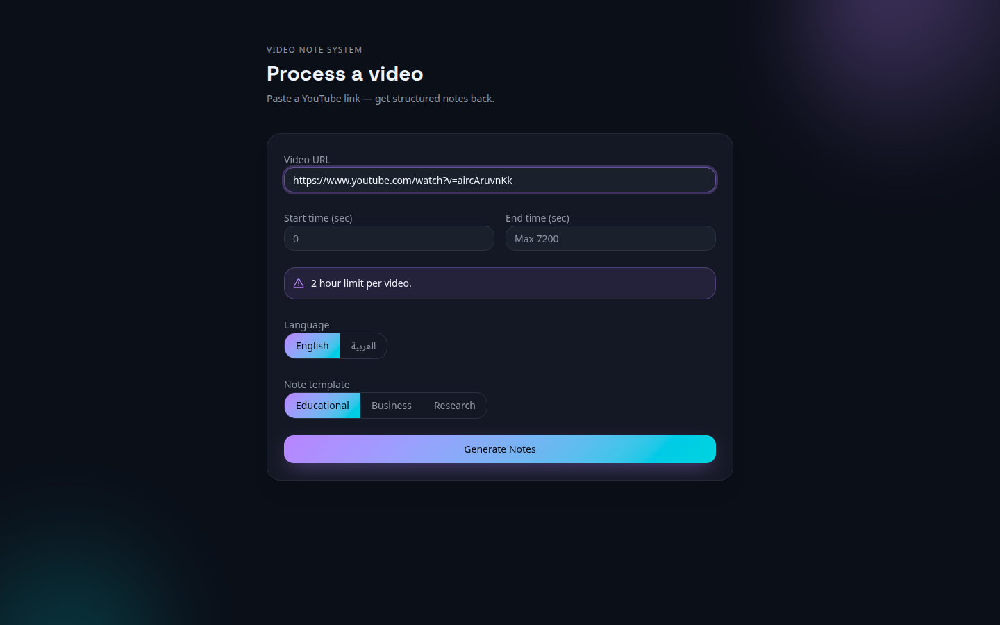
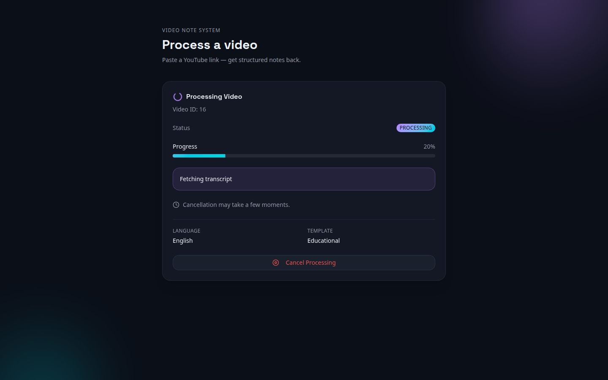
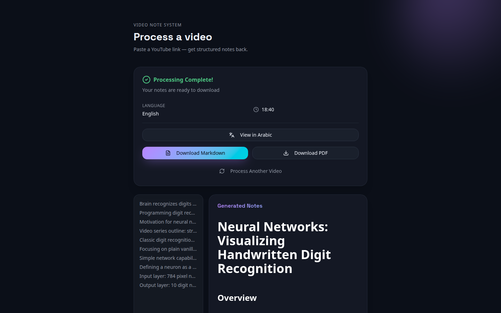
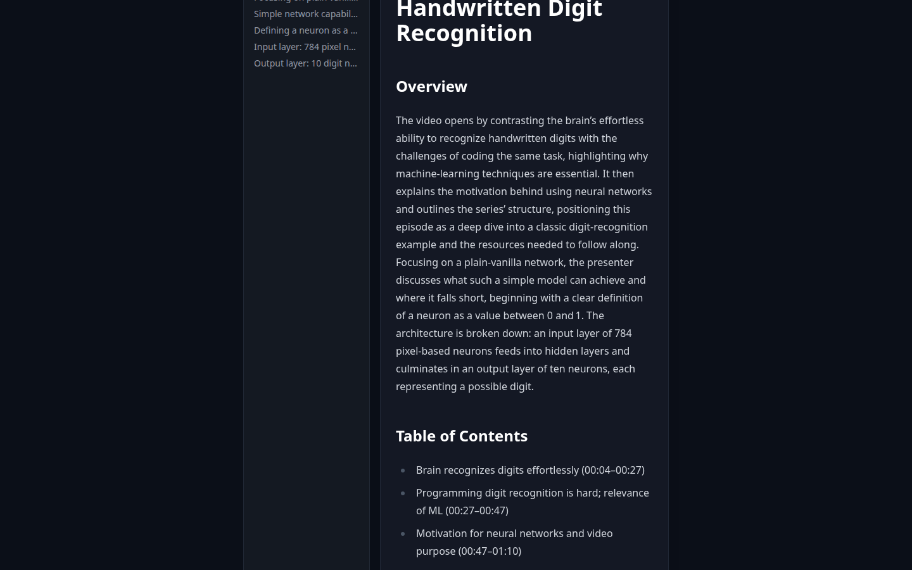
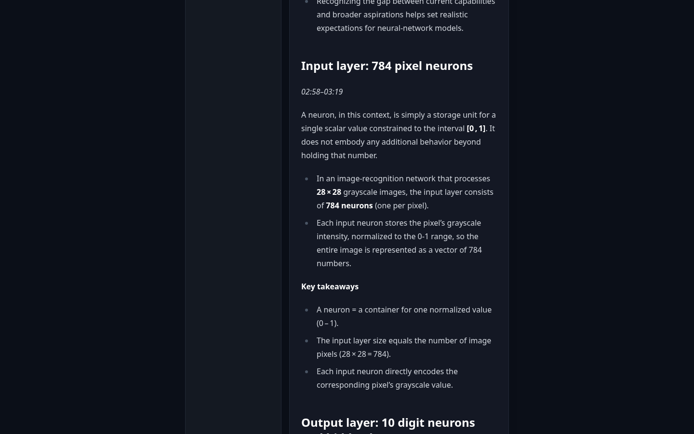
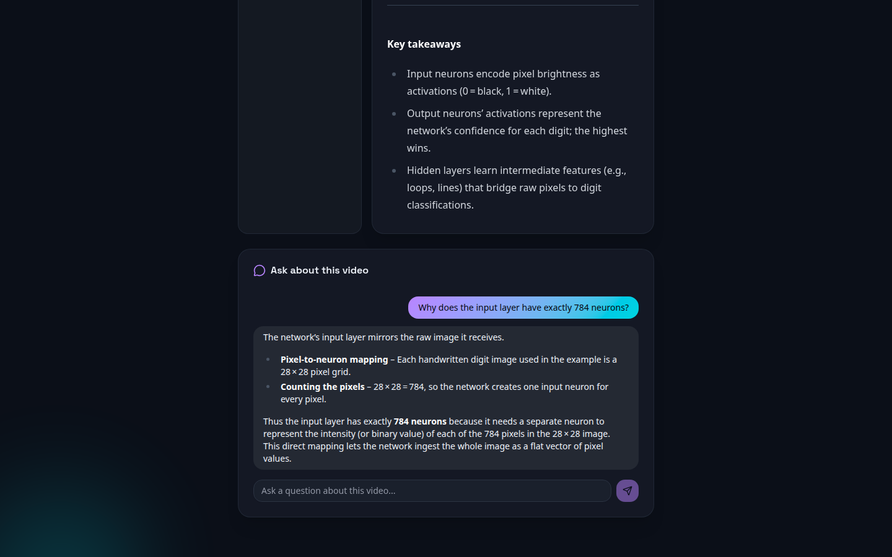
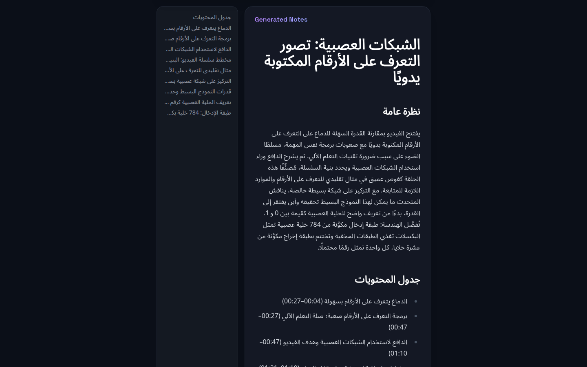

<div align="center">
  

  <p><b>Turn any YouTube video into structured, timestamped notes you can read, translate and ask questions about, in English or Arabic.</b></p>

  <p>
    
    
    
    
    
  </p>

  <p>
    <a href="#-features">Features</a> •
    <a href="#-how-it-works">How It Works</a> •
    <a href="#-tech-stack">Tech Stack</a> •
    <a href="#-getting-started">Getting Started</a> •
    <a href="#-screenshots">Screenshots</a> •
    <a href="#-version-history">Version History</a>
  </p>
</div>

---

##  About The Project

**Video Note System** bridges the gap between passive watching and active learning. Paste a YouTube link and get back notes organised like a study document: an overview, a table of contents with timestamps, and a clear section for every topic, with key takeaways. You can then switch the notes to Arabic or ask a chat assistant questions about the video.

It began as my Bachelor's Thesis Project at Vistula University (version 1). **Version 2** rebuilt the pipeline: it reads captions instead of downloading video, splits notes into real topics, and adds translation and a video-scoped chat.

### Why Video Note System?

* ✅ **Captions first, no video download** - Uses YouTube's own captions and only falls back to audio transcription when a video has none
* ✅ **Structured like a study document** - Overview, timestamped table of contents and one section per topic
* ✅ **Arabic as a first-class language** - Notes, translation, chat and PDF export all handle right-to-left text
* ✅ **Ask the video** - A chat assistant that answers only from that video's notes
* ✅ **Videos up to 2 hours** - Up from 20 minutes in version 1
* ✅ **Free-tier friendly** - Tuned to run within Groq's free tokens-per-minute limits

---

## ✨ Features

### 📹 Transcript Acquisition
* **Captions first** - Fetches manual, auto-generated or auto-translated YouTube captions via yt-dlp, with no video or audio download.
* **Clean caption parsing** - A custom VTT parser removes YouTube's duplicated "rolling" auto-caption lines.
* **Whisper fallback** - Only when a video has no captions at all, downloads the audio only and transcribes it with Groq Whisper Large-v3.
* **Time ranges** - Optionally process just part of a video (start / end time).

### 🧠 AI Note Generation
* **Topic segmentation** - The LLM splits the transcript into real topics with timestamps. The whole video is sampled evenly to fit the model's input budget, so long videos are covered end to end.
* **Section-by-section writing** - Each topic is written separately, then assembled with an overview and a table of contents.
* **Custom templates** - Educational, Business or Research note styles.
* **Model** - Groq `openai/gpt-oss-120b` (version 1 used LLaMA 3.3 70B, which Groq has since deprecated).

### 🌍 Translation & Chat
* **On-demand translation** - Switch notes between English and Arabic. Long notes are translated section by section, and results are cached.
* **Video-scoped chat** - Ask questions about the video. Answers come only from its notes, off-topic questions are declined, and replies match the language you write in.

### 📄 Export & Reading
* **In-browser reading** - Rendered Markdown with a clickable table of contents.
* **PDF export** - ReportLab, with correct bidirectional Arabic/Latin/number rendering and a bundled Arabic font.
* **Markdown export** - Clean `.md` files.

### 🛡️ Reliability
* **Live progress and cancellation** - Real-time status with graceful cancellation and resource cleanup.
* **Rate-limit aware** - Sequential LLM calls, capped request sizes and automatic retries on Groq 429s.
* **Repetition guard** - Protects against LLM repetition loops on repetitive input.

---

## 🔄 How It Works

1. **Submit** - The frontend sends the YouTube URL, language and template to the FastAPI backend. The job is queued in Celery.
2. **Get the transcript** - The video's length is checked, then captions are fetched. Whisper is used only if there are none.
3. **Segment** - The timestamped transcript is sampled evenly across the whole video and the LLM splits it into topics.
4. **Write** - Each topic section is generated from its part of the transcript, then an overview and table of contents are added.
5. **Read, translate, ask** - The notes are shown in the browser, can be translated to Arabic or exported, and can be questioned in the chat.

### System Design

```text
┌─────────────┐      ┌──────────────┐      ┌─────────────┐
│   Next.js   │ HTTP │   FastAPI    │      │   Celery    │
│  Frontend   │─────▶│   Backend    │─────▶│   Worker    │
│ (TypeScript)│      │   (Python)   │      │  (Async)    │
└─────────────┘      └──────────────┘      └─────────────┘
       │                    │                     │
       ▼                    ▼                     ▼
┌──────────────┐     ┌──────────────┐      ┌─────────────┐
│    Client    │     │ PostgreSQL   │      │   Redis     │
│   Browser    │     │  Database    │      │   Queue     │
└──────────────┘     └──────────────┘      └─────────────┘
                                                  │
                                                  ▼
                              ┌───────────────────────────────────┐
                              │ YouTube captions (yt-dlp)         │
                              │ Groq API: gpt-oss-120b + Whisper  │
                              └───────────────────────────────────┘
```

### ⏱️ Performance (measured locally, captioned videos)
* **2.5-minute video** - notes ready in ~21–25 seconds.
* **18-minute video** - notes ready in ~70 seconds (9 topics).
* **Arabic translation of the 18-minute notes** - ~85 seconds the first time, instant after that (cached).
* **Cost** - $0 on Groq's free tier.

---

## 🛠 Tech Stack

**Backend & AI Services**
* **Python 3.12 & FastAPI** - Async API.
* **Celery + Redis** - Background processing queue.
* **PostgreSQL & SQLAlchemy + Alembic** - Database, ORM and migrations.
* **Groq API** - `gpt-oss-120b` (notes, translation, chat) and Whisper Large-v3 (fallback transcription).
* **Processing tools** - yt-dlp, FFmpeg, ReportLab, arabic-reshaper, python-bidi.

**Frontend**
* **Next.js 16 & React 19** - App Router.
* **TypeScript** - Strict typing.
* **Tailwind CSS v4 + shadcn/ui** - Dark interface.
* **react-markdown + remark-gfm** - Rendered notes with a table of contents.
* **Axios** - HTTP client.

---

## 🚀 Getting Started

### 📋 Prerequisites
* **Python** 3.11+
* **Node.js** 18+
* **PostgreSQL** 14+
* **Redis** 7+
* **FFmpeg** (only needed for the Whisper fallback)
* A free **Groq API key** from [console.groq.com](https://console.groq.com)

### 1️⃣ Clone the Repository
```bash
git clone https://github.com/Moatazjad/video-note-system.git
cd video-note-system
```

Postgres and Redis can also be started with `docker compose up -d` using the included `docker-compose.yml`.

### 2️⃣ Backend Setup
```bash
cd backend
python -m venv .venv
source .venv/bin/activate        # Windows: .venv\Scripts\activate
pip install -r requirements.txt
cp .env.example .env             # then fill in DATABASE_URL and GROQ_API_KEY
alembic upgrade head             # create the database tables
```

### 3️⃣ Frontend Setup
```bash
cd frontend
npm install
cp .env.example .env.local
```

### 4️⃣ Start Services (3 terminals)
```bash
# Terminal 1: API
cd backend && uvicorn app.main:app --reload

# Terminal 2: Celery worker
cd backend && celery -A app.core.celery_app worker --pool=solo -l info

# Terminal 3: Frontend
cd frontend && npm run dev
```

Open http://localhost:3000.

### ☁️ Deployment
The backend includes a `Dockerfile`, `start.sh` and `render.yaml` for Render. On the free tier the API and Celery worker run in one container.

---

## 📸 Screenshots

| Paste a link | Live progress |
|---|---|
|  |  |

| Notes ready | Overview & table of contents |
|---|---|
|  |  |

| Topic section with key takeaways | Ask about the video |
|---|---|
|  |  |

| Notes in Arabic |
|---|
|  |

<details>
<summary>Version 1 screenshots (thesis submission)</summary>


</details>

---

## 🗂 Version History

### Version 2 (September–October 2026)
* Captions-first transcripts (no video download), with Whisper as a fallback only.
* Topic segmentation with timestamps, section-by-section writing, overview and table of contents.
* On-demand English ⇄ Arabic translation, cached.
* Video-scoped chat assistant.
* Video limit raised from 20 minutes to 2 hours.
* Arabic PDF export fixed (mixed Arabic/Latin/number text) and a bundled Arabic font.
* New dark interface with rendered Markdown.
* Render deployment setup.
* **Fixes (October 2026):**
  * Long videos were only segmented over their first few minutes, because the transcript was cut off instead of sampled. The whole video is now covered.
  * Short videos were split into too many tiny sections. The number of sections now scales with video length.
  * Translation of long notes could come back empty. It now runs section by section, with a retry.
  * Topic segmentation could fail on long videos because the model ran out of output tokens.
  * Off-topic chat refusals now reply in the user's language.

### Version 1 (March 2026, thesis submission)
* Download audio, transcribe with Whisper, generate notes with LLaMA 3.3 70B.
* Educational / Business / Research templates.
* Live progress, cancellation, Markdown and PDF export with Arabic support.
* Videos up to 20 minutes.

---

## 🔒 Security & Privacy

* **Environment isolation** - API keys are kept in environment variables, never in code.
* **Input validation** - URL validation on both client and server, plus path traversal protection for exports.
* **Safe external links** - `noopener`, `noreferrer`.

---

## 📄 License

Distributed under the **MIT License** for educational purposes.

---

## 👤 Author & Acknowledgments

### 🎓 Moataz Ahmed
* **Institution** - Vistula University, Warsaw (Computer Engineering).
* **Project** - Bachelor's Thesis 2026.
* **GitHub** - [@Moatazjad](https://github.com/Moatazjad).
